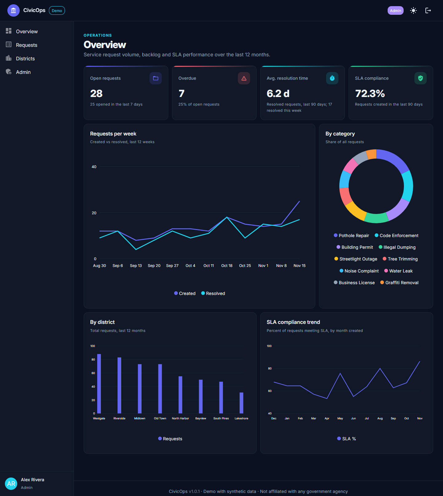
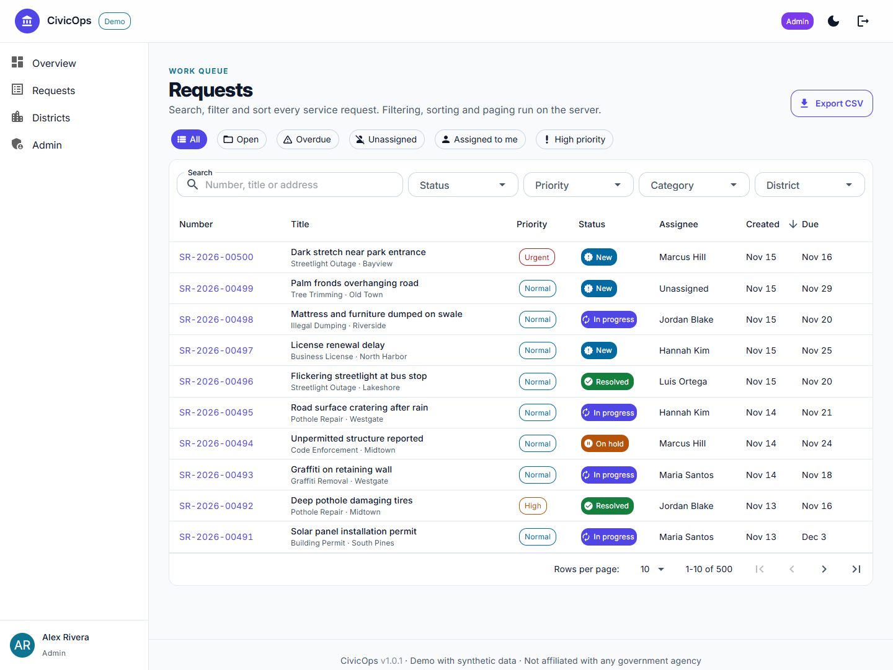
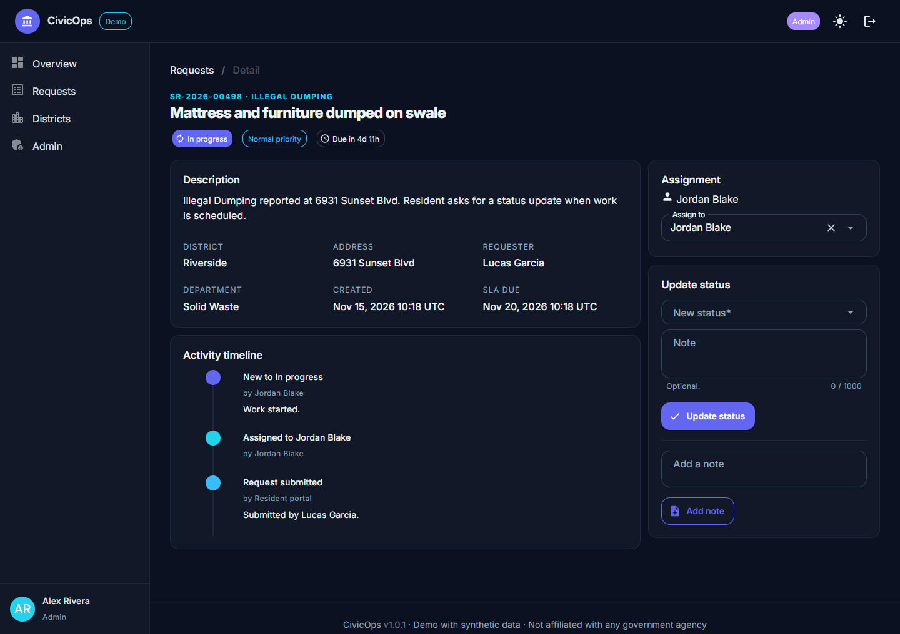
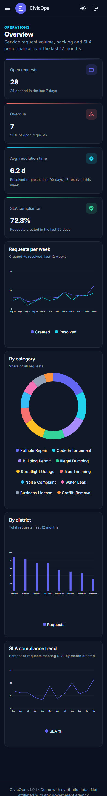

# CivicOps

A government-style **service-request and permit operations dashboard**: KPIs, SLA tracking, a server-side requests grid, request workflow with timeline, district breakdown and an admin area. It is a portfolio demo that runs on **synthetic data** and is not affiliated with any government agency.

Built with .NET 11, Blazor (Interactive Server), MudBlazor, EF Core + SQLite and ASP.NET Core Identity, with no JavaScript written by hand.

## Screenshots

| Overview (dark) | Requests grid (light) |
| --- | --- |
|  |  |

| Request detail (dark) | Mobile overview (390px, dark) |
| --- | --- |
|  |  |

## Features
- **Overview**: KPI tiles (open, overdue, average resolution time, SLA compliance) and charts: requests per week (line), by category (donut), by district (bar), SLA compliance trend (line).
- **Requests**: `MudDataGrid` with server-side paging, sorting and filtering (search, status, priority, category, district), quick filters (open, overdue, unassigned, assigned to me, high priority), status chips, and **CSV export** through a server endpoint (a plain download link, no JS). Exports neutralize spreadsheet formulas.
- **Request detail**: `MudTimeline` of status changes, assignments and notes; assignment; validated status-update form that enforces the workflow (notes required for hold, resolve, cancel and reopen).
- **Districts**: map-free breakdown table with workload per 10,000 residents, overdue counts, average resolution time and SLA compliance bars.
- **Admin**: categories, departments and per-priority SLA hours; admin-only **Reset demo data** button.
- **Auth**: ASP.NET Core Identity cookie sign-in, roles **Admin, Supervisor, Agent, Viewer**, and a "Try the demo" page with one-click logins using plain form posts. Viewer is read-only.
- **Design**: dark-first navy + indigo/cyan theme shared with my personal site, light/dark toggle through a cookie (no JS), responsive and mobile-first, accessible (aria-labels, tooltips, skip link, 44px tap targets).

### Roles
| Role | Can do |
| --- | --- |
| Viewer | Read dashboards, requests, districts, export CSV |
| Agent | Viewer + add notes and update status on requests assigned to them |
| Supervisor | Agent + assign requests and update any request |
| Admin | Supervisor + edit categories/SLA rules and reset demo data |

Demo accounts: `admin@civicops.demo`, `supervisor@civicops.demo`, `agent@civicops.demo`, `viewer@civicops.demo`, all with password `Demo!2026pass` (public on purpose; synthetic demo).

## Tech stack
.NET SDK 11, Blazor Web App (Interactive Server), MudBlazor 9.13, EF Core 11 (SQLite), ASP.NET Core Identity, xUnit with `WebApplicationFactory`. Self-hosted Inter font. No CDNs, no external UI libraries, no custom JavaScript.

## Run locally
```
dotnet run
```
Open http://localhost:5110. The SQLite database is created and seeded in `App_Data/civicops.db` on first start (about 500 requests across ten categories and eight districts, dated over the last 12 months, regenerated relative to the day you first run it). Delete the file to start over, or use Admin > Reset demo data.

```
dotnet build CivicOps.slnx
dotnet test CivicOps.slnx
```

## Architecture notes
- **Layers**: Razor pages call small services (`RequestQueryService`, `RequestCommandService`, `DashboardService`, `AdminService`). Each service call takes an `Actor` (id, name, role) and re-checks permissions, so the UI hides actions *and* the server refuses them.
- **Auth in Blazor Server**: cookies cannot be set over SignalR, so sign-in/out are minimal-API form posts with antiforgery tokens. Pages needed before sign-in (login, access denied, errors) are static SSR (`[ExcludeFromInteractiveRouting]`); everything else is interactive and sits behind a fallback "authenticated user" policy. `/admin` additionally requires the Admin role.
- **Data**: SQLite via EF Core with `IDbContextFactory` (safe in long-lived circuits). UTC `DateTime` everywhere because SQLite cannot order `DateTimeOffset`. Schema is created with `EnsureCreated` (no migrations; this is a demo).
- **Workflow**: `StatusRules` is the single source of truth for allowed transitions (New to In progress/Canceled, In progress to On hold/Resolved/Canceled, On hold to In progress/Canceled, Resolved to Closed or reopen, Closed and Canceled are final).
- **SLA**: each category has a target in hours per priority; `DueAt` is set from it when a request is created. Compliance counts resolved-on-time vs. resolved-late or open-and-overdue.
- **Hosting**: self-contained `win-x86` publish, `web.config` out-of-process with WebSockets, HTTPS redirect and HSTS in the app. SQLite file and data-protection keys live in `App_Data`.

## Deployment
See [docs/DEPLOYMENT.md](docs/DEPLOYMENT.md). The GitHub Actions workflow builds and tests on every push and deploys by FTPS only when the repo variable `DEPLOY_ENABLED` is `true`. Uploads never delete server files and exclude `App_Data/` and `*.db`, so live data is not overwritten by later deployments.

## License
MIT, see [LICENSE](LICENSE).
